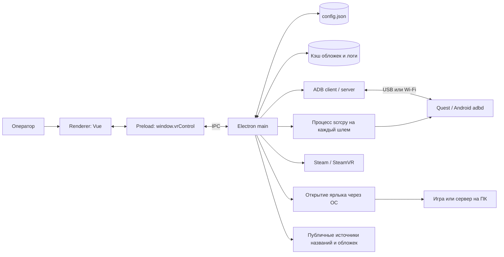
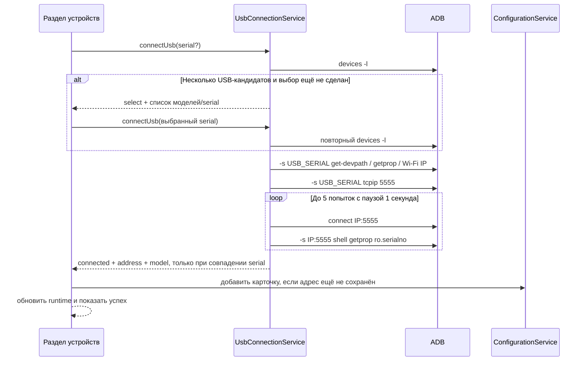

# Software Design Description — VR Control Center

Статус: описание реализованной системы в текущей ветке. Проверено по исходникам
7 ноября 2026 года. Планируемые гарантии отдельно перечислены в
[ограничениях](known-limitations.md). Инструкции для работы находятся в
[руководстве оператора](operations.md).

## 1. Назначение и границы

Приложение помогает оператору арены подключать несколько Quest, видеть их
состояние, запускать независимые трансляции scrcpy, открывать приложения на шлемах
и ярлыки игр на ПК на локальном ПК. Поддерживаются русский и английский UI,
оформление OnePlace и системный трей. Типографика, статичный фон и правила
иконок/анимации описаны в [визуальном стиле](ui-style.md).

Основная поставка — Windows x64 с собственными ADB и scrcpy. Разработка доступна
на macOS; там инструменты устанавливаются отдельно. Наличие отдельных Linux-веток
в коде не означает проверенную поставку для Linux.

Приложение не является игровым сервером или агентом внутри Quest. Нет облачного
backend, входящего API для удалённого управления, аккаунтов и разделения ролей.
Шестерёнка настроек — способ организации UI, а не ограничение прав оператора.
Трансляция открывается отдельным окном scrcpy, не встраивается в Vue.

### Термины

| Термин             | Значение                                                            |
| ------------------ | ------------------------------------------------------------------- |
| `deviceId`         | Локальный ID карточки, не серийный номер железа                     |
| `address`          | Сохранённый IPv4 и TCP-порт, например `192.168.1.10:5555`           |
| USB serial         | Временный адрес выбранного USB-транспорта ADB                       |
| Аппаратный serial  | `ro.serialno`, сравнивается при USB → Wi-Fi                         |
| Runtime            | Непостоянное состояние соединения, батареи, приложения и трансляции |
| Поколение операции | Счётчик актуальности асинхронной работы конкретной карточки         |

## 2. Контекст и процессы

- **Main** владеет конфигурацией, файлами, дочерними процессами и обращениями к сети.
- **Preload** публикует ограниченный типизированный API через `contextBridge`.
- **Renderer** отображает UI и держит состояние представления. В окне включены
  `contextIsolation` и `sandbox`, отключён `nodeIntegration`.
- **ADB** — внешний клиент и общий сервер ADB на ПК. Приложение адресует устройства
  явно, но не владеет сервером эксклюзивно и не останавливает его при выходе.
- **scrcpy** — отдельный управляемый процесс для каждого `deviceId`. Его нагрузка
  на декодирование видео существует и при скрытом основном окне.
- **Командная игра** открывается ОС; её процесс не принадлежит менеджеру scrcpy.

Исходники: [создание окна](../src/main/bootstrap/create-main-window.ts),
[preload](../src/preload/index.ts), [композиция приложения](../src/main/bootstrap/create-application.ts).

## 3. Запуск и завершение

`src/main/index.ts` ждёт готовности Electron и вызывает `createApplication`:

1. Применяет брендинг и настраивает технический лог.
2. Создаёт `ConfigurationService`, `ScrcpyService`, `HeadsetRuntimeManager`.
3. При необходимости копирует legacy-конфигурацию `arena-control-center`.
4. Загружает/нормализует конфигурацию и применяет уровень логирования.
5. Регистрирует IPC, обработчики окна и трей.
6. Инициализирует runtime и таймеры, создаёт окно.

Специальный аргумент `--verify-bundled-tools <report.json>` вместо обычного запуска
проверяет встроенные инструменты и завершает процесс. Он нужен CI, не открывает
основное окно и не запускает обычный runtime.

Закрытие окна следует `closeBehavior`: `quit`, `ask` или `minimizeToTray`.
Скрытие сохраняет соединения и трансляции. При выходе прекращаются таймеры runtime
и отправляется команда завершения процессам scrcpy. Обработчик выхода пока не
ожидает гарантированного `close` каждого процесса. Внешние игры продолжают работать.
Подробности: [lifecycle](../src/main/bootstrap/lifecycle.ts).

## 4. Модули и ответственность

| Узел                  | Ответственность и исходник                                                                                             |
| --------------------- | ---------------------------------------------------------------------------------------------------------------------- |
| Bootstrap             | Порядок запуска, зависимости и регистрация IPC: `src/main/bootstrap/`                                                  |
| Configuration         | Валидация, сериализация обновлений и сохранение: [service](../src/main/modules/configuration/configuration.service.ts) |
| Devices               | Соединения, runtime, очереди и reconnect: [manager](../src/main/modules/devices/device-runtime.manager.ts)             |
| Streaming             | IPC-команды запуска/остановки: `src/main/modules/streaming/`                                                           |
| Applications          | Список и запуск Android-приложений: [service](../src/main/modules/applications/applications.service.ts)                |
| PC games              | Проверка пути, CRUD и открытие ярлыков: [service](../src/main/modules/team-games/team-games.service.ts)                |
| ADB infrastructure    | Команды, USB-настройка и время: `src/main/infrastructure/adb/`                                                         |
| scrcpy infrastructure | Сессии дочерних процессов и их статусы: [service](../src/main/infrastructure/scrcpy/scrcpy.service.ts)                 |
| Binary resolver       | Выбор `auto/system/bundled/custom`: [resolver](../src/main/infrastructure/binaries/binary-resolver.ts)                 |
| Metadata              | Скачивание, проверка и кэш обложек: [service](../src/main/infrastructure/metadata/application-metadata.service.ts)     |
| Process runner        | Короткие команды с таймаутами: [runner](../src/main/infrastructure/process/process-runner.ts)                          |
| Shared                | IPC-типы, defaults, валидаторы и парсеры без UI                                                                        |
| Renderer              | Компоненты, локализация, журнал и composables: `src/renderer/src/`                                                     |

Main строит зависимости явно; общего DI-контейнера нет. Handler связывает IPC с
сервисом, инфраструктура выполняет внешние операции. Renderer не должен запускать
команды или читать файлы самостоятельно.

## 5. Данные и IPC

### Постоянные данные

`ConfigurationService` хранит `config.json` под `app.getPath('userData')`.
Обычно это `%APPDATA%\vr-control-center` на Windows и
`~/Library/Application Support/vr-control-center` на macOS; фактический путь
доступен в диагностике. Единственный источник схемы —
[config.contracts.ts](../src/shared/contracts/config.contracts.ts), версия схемы `1`.

| Поле               | Назначение                                                                                    |
| ------------------ | --------------------------------------------------------------------------------------------- |
| `application`      | Отображаемое имя приложения                                                                   |
| `devices[]`        | `id`, `name`, `address`, `streamProfileId`                                                    |
| `streamProfiles[]` | Параметры scrcpy: размер, FPS, bitrate, codec, crop, звук                                     |
| `teamGames[]`      | `id`, название, описание, путь ярлыка, optional `customIcon`, `steamAppId`, `requiresSteamVr` |
| `settings`         | Активные записи, язык, reconnect, опрос, закрытие, источники инструментов, логирование        |
| `logger`           | Параметры схемы логирования; текущая реализация файлового лога использует лимит 5 MiB         |

Начальные значения: [default-config.ts](../src/shared/config/default-config.ts).
Пустой список шлемов и игр на ПК; профиль Balanced: H.264, 1280, 30 FPS,
6M, без звука. Автоподключение включено, интервал 10 секунд (допустимо 5–30), источник инструментов
`auto`, закрытие `quit`. Язык выбирается по локали ОС (`ru`, иначе `en`).
`settings.steamDirectory` при наличии сохраняет выбранный корневой каталог Steam.
У обычной карточки путь обязателен; у Steam-карточки вместо него хранится числовой
AppID, а `shortcutPath` может быть пустым. Старые записи без новых полей остаются
обычными ярлыками без подготовки SteamVR.
Поле `launchAtStartup` есть в схеме, интеграция автозапуска ещё не реализована.

Загрузка происходит один раз и затем обслуживается из памяти. Обновления проходят
общую Promise-очередь в main: клонирование → нормализация → временный файл → rename
→ публикация нового состояния и уведомление внутренних слушателей. Ошибка одной
операции не ломает очередь. Это защита внутри экземпляра приложения; блокировки
файла между несколькими запущенными экземплярами нет.

При отсутствии файла создаются defaults; для повреждённого JSON/схемы выполняется попытка резервирования
перед восстановлением defaults. Ошибка резервирования записывается в лог. Ошибки доступа к диску не маскируются сбросом.
Дубли адресов отклоняются при CRUD; профиль, используемый шлемами, нельзя удалить.
Внешние изменения файла не отслеживаются: перед ручной правкой приложение закрывают.

### Непостоянные данные

Соединения, PID, статусы scrcpy, батарея, foreground, ошибки, очереди и USB serial
не записываются в конфигурацию. Пользовательский журнал хранит до 80 событий в
памяти renderer. Технический лог main пишется через electron-log с лимитом файла
5 MiB. Путь доступен в настройках; debug-вывод команд может содержать адреса и пути.
Фильтрация ключей `token/secret/password` не является полной очисткой содержимого логов.

Дисковый кэш названий и обложек — `userData/application-artwork/<package>.json`.
Это восстанавливаемый кэш, не пользовательская конфигурация. Аналогичный кэш
классификации VR и обложек Steam находится в `userData/steam-metadata`.

### Интерфейсы

Renderer обращается к `window.vrControl`; точные методы и формы результатов заданы
в [app.contracts.ts](../src/shared/contracts/app.contracts.ts) и связанных контрактах.

| Группа        | Основные операции                                                                  | Контракт                    |
| ------------- | ---------------------------------------------------------------------------------- | --------------------------- |
| App           | Версия, платформа, выбор бинарника, путь и очистка старых логов                    | `app.contracts.ts`          |
| Configuration | Чтение/reset, CRUD устройств и профилей, изменение настроек/языка                  | `config.contracts.ts`       |
| Headset       | Проверка инструментов, список ADB, USB, connect/disconnect, refresh, время, scrcpy | `headset.contracts.ts`      |
| Applications  | Список, обложка и запуск по `deviceId + packageName`                               | `applications.contracts.ts` |
| PC games      | Выбор ярлыка/PNG, иконки, Steam-синхронизация, CRUD и запуск по ID                 | `team-games.contracts.ts`   |

Контракты находятся в `src/shared/contracts/`, регистрация —
[register-ipc.ts](../src/main/bootstrap/register-ipc.ts).
Состояние runtime и scrcpy доставляется событиями. Технический stdout/stderr scrcpy
не пересылается как сырой поток в renderer. Configuration и Applications используют
типизированные результаты, но некоторые headset-операции могут отклонить Promise;
единой формы ошибок для всех групп пока нет. TypeScript не заменяет runtime-валидацию
входа main; проверки находятся в handlers и services, их полнота различается.

## 6. Сценарии и управление состоянием

### 6.1. Первичное подключение через USB

Renderer хранит USB-операцию в `useUsbConnection` между переключениями разделов.
Модальное окно открывается только для результата `select` с несколькими шлемами;
после выбора закрывается, а прогресс и итог видны в разделе устройств. Ошибки и
успех также записываются в пользовательский журнал. После `SAVE_FAILED` сохраняется
подтверждённый результат для повтора записи без перезапуска ADB TCP/IP.

[UsbConnectionService](../src/main/infrastructure/adb/usb-connection.service.ts)
блокирует одновременные USB-настройки на весь экземпляр приложения. Без USB
возвращает ошибку; один кандидат выбирается автоматически, несколько требуют
выбора. Сетевые, mDNS и emulator serial исключаются. Проверяется состояние
авторизации и devpath; учитываются `usb:`, libusb-пути и `unknown` native Windows.

IPv4 читается с `wlan0`; несколько подходящих адресов не угадываются. До `tcpip`
считываются модель и `ro.serialno`. Успех требует подтверждения команды tcpip,
подключения по сети и совпадения hardware serial. Это проверка именно при настройке,
не постоянная аппаратная привязка карточки.

Сохранение выполняется из UI после успешного IPC. Совпадение адреса переиспользует
карточку, сохраняя её имя и профиль. При новом IP создаётся новая карточка.
При ошибке сохранения окно помнит подтверждённый результат и предлагает повторить
сохранение. Существующие карточки на ошибке не переписываются. Изменения на самом
шлеме, например уже включённый TCP/IP, автоматически не откатываются.

### 6.2. Подключение, отключение и гонки

Обычное подключение: `adb connect address`; отключение: остановка scrcpy этого
шлема и `adb disconnect address`. Батарея и другие shell-команды адресуются через
`adb -s address`. Поиск нового IP по сети автоматически не выполняется.

В `HeadsetRuntimeManager` отдельная очередь управляющих операций на каждый
`deviceId`: connect/disconnect, start/stop stream и установка времени. Медленный A
не блокирует управление B. Ручные connect/disconnect увеличивают поколение
немедленно; disconnect сразу приостанавливает reconnect. Удаление/смена адреса
инвалидируют поколение, останавливают старую трансляцию и пересоздают runtime.

Асинхронная работа перед применением результата проверяет актуальность поколения
и адреса. Старое чтение батареи не должно вернуть connected после ручного
отключения. Проверка актуальности отбрасывает результат, но не отменяет уже
отправленную внешнюю команду.

Фоновый reconnect проверяет кандидатов каждые 5 секунд, использует до трёх workers
и интервалы попыток 10/20/40/60 секунд. Эти значения не гарантируют точный момент
запуска: есть шаг таймера, очередь и длительность команд. Ручной connect разрешает
reconnect после ручного disconnect. Флаг приостановки не переживает перезапуск
приложения. Потерянная трансляция автоматически повторно не запускается.

Запуск Android-приложений и USB-настройка имеют собственные блокировки и пока
не входят в эту общую очередь; см. [ограничения](known-limitations.md).

### 6.3. Трансляции

Менеджер перед стартом проверяет точный ADB-транспорт и выбирает профиль карточки
или первый доступный профиль; без профилей используются fallback-параметры. `ScrcpyService` создаёт сессию в
`Map<deviceId, session>` и запускает `scrcpy --serial address ...`.
`ADB` передаётся через окружение, для встроенного комплекта также задаётся
`SCRCPY_SERVER_PATH`. Другие шлемы не выбираются автоматически.

Начальное состояние — `stopped`, запуск проходит `starting → running`,
остановка — `stopping → exited`. Неожиданный выход даёт `exited`/`error`. `running` означает успешный spawn процесса, а не наличие
первого видеокадра. PID и события сверяются с текущей сессией.

Остановка сохраняет слот до `close`. Через 2 секунды отправляется SIGKILL,
`stopAndWait` ждёт до 5 секунд. Без подтверждённого закрытия возвращается ошибка,
слот остаётся занят, дублирующий scrcpy не запускается. Очередь позволяет stop→start
одного шлема дождаться завершения; A и B имеют независимые процессы.

### 6.4. Опрос и фоновый режим

Таймер runtime просыпается раз в секунду, но реальные проверки транспортов
определяются `runtimePollingIntervalSeconds` (по умолчанию 10 секунд). На фоновый
проход делается один общий `adb devices -l` для карточек, которым пора обновиться.
Чтение телеметрии отделено от обнаружения транспорта: зависший dumpsys не должен
задерживать следующий проход обнаружения.

| Действие                 | Видимое окно                       | Все окна скрыты или свёрнуты |
| ------------------------ | ---------------------------------- | ---------------------------- |
| Проверка ADB-транспортов | Настроенный интервал               | Тот же интервал              |
| Reconnect                | Проверка каждые 5 секунд + backoff | Без изменения                |
| Батарея                  | Не чаще раза в 30 секунд           | Не чаще раза в 120 секунд    |
| Foreground-приложение    | Настроенный интервал               | Не чаще раза в 60 секунд     |
| Активная трансляция      | Работает                           | Продолжает работать          |

Больший интервал опроса и время выполнения могут уменьшить частоту дополнительно.
Есть максимум два одновременно выполняемых запроса телеметрии; ручное управление
не ждёт этой очереди. Foreground имеет fallback через другой dumpsys. Пропущенное
чтение сохраняет предыдущее значение.

Возврат окна запрашивает свежую телеметрию, при незавершённом чтении — после него.
Ручной refresh, connect и успешный запуск Android-приложения также запрашивают
обновление без ограничения частоты батареи. Наличие одного видимого окна сохраняет
обычный режим. События состояния по IPC скрытому окну пока не подавляются.

### 6.5. Приложения и обложки

`ApplicationsService` проверяет подключение и запрашивает MAIN activities по
категориям LAUNCHER, LEANBACK_LAUNCHER и INFO текущего Android-пользователя.
Пакет показывается один раз. Список сразу обогащается локальным кэшем; затем UI
автоматически обновляет названия/изображения с максимум четырьмя workers.

Перед запуском список запрашивается заново: UI передаёт package name, компонент
выбирается main из ответа устройства. Выполняется `am start --user current -W`;
проверяется не только exit code, но и текст Android-ошибок. Есть блокировка
одновременных запусков по `deviceId` и проверка изменения адреса. После успеха
запрашивается runtime. Общего поколения с disconnect пока нет.

Источники: MetaMetadata и QuestLauncherImages под `threethan` на GitHub,
дополнительные URL из метаданных на CDN Oculus/Meta. Это внешние данные; код
LightningLauncher и его ресурсы в приложение не копируются. Для lookup вариант
`.mrf.` нормализуется в `.`. Неизвестный пакет остаётся запускаемым с placeholder.

Загрузчик разрешает HTTPS на `raw.githubusercontent.com`, поддоменах
`oculuscdn.com`/`fbcdn.net`, проверяет redirect (до 3), размеры и сигнатуру PNG/JPEG/WebP.
Один запрос имеет таймаут 5 секунд, JSON ограничен 64 KiB, изображение — 2 MiB.
Свежесть кэша с изображением — 7 дней, без изображения — 1 час; в памяти есть пауза
5 минут перед повтором после загрузки. Свежий/доступный дисковый кэш позволяет
работать без интернета, но первая загрузка обложек требует сети.

Оперативный LRU ограничен 256 записями и оценкой 16 MiB. Это бюджет сохранённых
строк и служебных данных, не всей памяти Electron. Дисковый кэш не имеет общего
лимита объёма/автоочистки. Запросы одного пакета дедуплицируются.

### 6.6. Время и игры на ПК

Установка времени использует часы ПК `Date.now()` в миллисекундах Unix:
`adb -s address shell service call alarm 2 i64 TIMESTAMP_MS`.
Есть один аргумент `i64`. Проверяются boolean Binder-ответ и последующее
`date +%s` с расхождением не более 10 секунд. Часовой пояс и auto-time не меняются.
Это private Android-операция: прошивка может её запретить. Отказ не обходится root.
Проверка актуальности выполняется между командами; уже отправленное изменение
времени не откатывается при последующем disconnect или ошибке проверки.

`TeamGamesService` сохраняет локальный абсолютный путь, проверяет расширение и
наличие файла. Windows: `.lnk/.url/.exe/.bat/.cmd`; macOS:
`.app/.webloc/.command`. ОС открывает путь через `shell.openPath`, сохраняя смысл
ярлыка, его аргументы и рабочую директорию. Есть блокировка параллельного запуска
по ID и 3-секундная защита от повтора после успеха; максимум 100 записей.
Иконка карточки выбирается в порядке: собственная PNG → системная иконка ярлыка
через Electron `app.getFileIcon` → монограмма OnePlace. `team-games:icon` возвращает
локальный data URL; извлечение выполняется при показе/изменении карточки, без
фонового опроса. Изменение пути обновляет иконку, пока не задана собственная PNG.

Выбор PNG выполняется нативным диалогом в main. Проверяются PNG-сигнатура, IHDR,
размер до 2 MiB, стороны до 4096 пикселей и возможность декодирования. Картинка
уменьшается до 512 пикселей по большей стороне и сохраняется в
`userData/team-game-icons/<sha256>.png`. В конфигурации хранится только имя
`customIcon`, исходный путь не нужен. Имена допускают только SHA-256 + `.png`;
дубли одинакового нормализованного PNG используют один файл. Reset убирает override,
не удаляя файлы. Несохранённый выбор не меняет карточку, но импортированная копия
может остаться на диске; автоматической очистки неиспользуемых PNG пока нет.

Удаление карточки не удаляет ярлык. Успех означает принятие команды ОС, готовность
игрового сервера и состояние внешнего процесса не отслеживаются.

### 6.7. Steam и подготовка SteamVR

[SteamLibraryService](../src/main/infrastructure/steam/steam-library.service.ts)
ищет корень Steam в сохранённом `steamDirectory`, Windows HKCU SteamPath либо
стандартных каталогах платформы. `steamapps/libraryfolders.vdf` определяет
дополнительные библиотеки. KeyValues разбираются отдельным парсером; содержимое
файлов не выполняется. Читаются `appmanifest_<AppID>.acf`, проверяются бит
установленности `StateFlags & 4`, совпадение ID с именем manifest и наличие каталога
игры внутри `steamapps/common`. Путь из manifest не может выйти из этого каталога.

Поддержка VR определяется через ответ `store.steampowered.com/api/appdetails` для
установленного AppID: `type=game` и категория 31/53/54 (VR Support/VR Supported/VR Only).
Проверяется собственная декларация магазина, не название игры или наличие контроллера.
SteamVR (250820) исключается из игрового импорта. Это публичный endpoint магазина
без ключей/логина, его формат и доступность не гарантируются приложением.

Сетевой этап имеет бюджет 30 секунд на выдачу новых запросов, два worker,
таймаут 5 секунд на запрос; уже выданные запросы могут завершаться после бюджета.
Размер metadata-ответа — до 256 KiB. Проверенная классификация и картинка хранятся
7 дней; при ошибке сети используется старый проверенный кэш. Непроверенные пакеты
считаются unresolved и доступны следующей попытке. Обложки скачиваются только по
HTTPS с поддоменов `steamstatic.com`, без redirect, до 1 MiB, с проверкой PNG/JPEG
сигнатуры; renderer получает data URL. Собственная PNG имеет приоритет.

При входе в раздел и ручном refresh запрашивается синхронизация. Общий Promise
дедуплицирует одновременные импорты. Новые карточки добавляются одним обновлением
конфигурации с ID `steam-<AppID>`, по AppID отсеиваются дубли. Настройки существующих
карточек сохраняются; автоматического удаления и скрытия импортированных игр нет.
Без новых карточек конфигурация повторно не записывается. Постоянного таймера Steam
и сетевого сканирования в фоне нет; уже начатый конечный scan может завершиться
после закрытия раздела. Все записи вместе ограничены 100 карточками.

[SteamVrService](../src/main/infrastructure/steam/steamvr.service.ts) применяется
к карточкам с `requiresSteamVr`. В Windows x64 helper
[ensure-steamvr.ps1](../resources/steamvr/ensure-steamvr.ps1) загружает установленный
`SteamVR/bin/win64/openvr_api.dll` и проверяет `VR_InitInternal` с
`VRApplication_Background`. Успех означает доступное соединение с runtime; клиент
сразу отсоединяется через `VR_ShutdownInternal`, не останавливая сам SteamVR.
При неготовности helper проверяет наличие vrserver/vrmonitor/vrstartup: если
SteamVR уже запускается, ожидает его; иначе один раз открывает фиксированный
`steam://run/250820`. Проверка повторяется до 45 секунд. Таймаут всего процесса — 60 секунд плюс штатный
предел завершения process runner. Проверка не запускает SteamVR сама по себе:
Background не должен стартовать runtime. Повторные запросы подготовки разделяют
один Promise; последующие игровые запуски заново проверяют текущее состояние.

Только после успешного helper открывается пользовательский ярлык либо
`steam://run/<validated AppID>`. Это не переключает VR-режим игры принудительно.
Ошибка helper возвращает `STEAMVR_NOT_READY`, отсутствие SteamVR/поддержки платформы —
`STEAMVR_UNAVAILABLE`; игра при этом не открывается. Доступность установленной
Steam-игры проверяется до запуска. Блокировка карточки удерживается во время всей
подготовки, изменение/удаление в этот момент запрещено. Native OpenVR не загружается
в Electron: C# P/Invoke изолирован в краткоживущем PowerShell-процессе. Команды/URI
из игровых manifest не выполняются. Установку Steam/SteamVR и PC VR-транспорт
приложение не настраивает.

## 7. Инструменты и поставка

`auto` использует встроенный комплект на Windows x64, если он доступен; на macOS
используется PATH. `system` использует PATH, `custom` — заданный путь. Явный
`bundled` на неподдерживаемой платформе даёт ошибку. Старые явные настройки
PATH/custom сохраняются при обновлении.

Для Windows дополнительно упаковывается first-party helper в `resources/steamvr`.
Он использует DLL установленного SteamVR; сама DLL в приложение не включается.

Windows-комплект фиксируется в [windows-tools.lock.json](../scripts/windows-tools.lock.json):
официальный ZIP scrcpy 5.0.1 с ADB 37.0.1, сервером и DLL. Подготовка проверяет
SHA-256 архива и сохраняет полный upstream-набор с пофайловым manifest.
Сгенерированные бинарники игнорируются Git. Builder копирует их в
`resources/tools/win32-x64/scrcpy`; уведомления о лицензиях — в
`resources/third-party`.

Поставка, CI и проверка упакованного Electron описаны в
[testing-and-release.md](testing-and-release.md). Отдельная установка Node.js,
ADB или scrcpy пользователю Windows-сборки не требуется. Это не включает системные
USB-драйверы, разрешения Android и настройки сети. Автообновления приложения нет.

## 8. Границы доверия и безопасность

Локальный main — привилегированная часть приложения. Разрешённые действия задаются
конкретными IPC-методами; универсального shell API нет. Аргументы ADB строит main,
Android-компонент повторно определяется с устройства. Путь командной игры выбирает
оператор; расширение и наличие файла проверяются, но доверие к содержимому ярлыка
остаётся ответственностью локальной установки.

Renderer изолирован средствами Electron, однако в IPC пока нет единого слоя
проверки отправителя и всех входных payload. Это локальное приложение без границы
административных ролей. Изменения загрузки страниц, внешней навигации и IPC нужно
рассматривать как изменения этой границы, а не как обычную косметику UI.

Отладка Quest требует разрешения владельца устройства. Включение TCP/IP открывает
сетевой ADB на шлеме; приложение не настраивает роутер, брандмауэр, VLAN или
изоляцию клиентов. Внешние игры также могут требовать собственных сетевых правил.

Обложки шлема загружаются только при online-обогащении библиотеки; package name попадает
в запрос публичному источнику. Аккаунтов Meta и секретных ключей для этого не нужно. Steam-проверка отправляет
AppID установленных игр магазину Steam, но не требует входа в Steam-аккаунт внутри
приложения.
Изображения проверяются в main и выдаются renderer как data URL, а не произвольный
удалённый HTML. Конфигурация и кэш не шифруются. Логи следует просматривать перед
передачей третьим лицам.

## 9. Принятые решения и проверяемые границы

| Решение                                   | Причина                                           | Цена/граница                                               |
| ----------------------------------------- | ------------------------------------------------- | ---------------------------------------------------------- |
| Локальный Electron + typed preload        | Нативные процессы и единый desktop UI             | Расход памяти Chromium; IPC требует runtime-проверок       |
| Один main владеет конфигурацией           | Упорядоченные изменения без потери обновлений     | Нет межпроцессной блокировки или внешнего file watcher     |
| Отдельная очередь на шлем                 | Изоляция управления несколькими устройствами      | Очередь не покрывает пока все операции                     |
| Поколения результатов                     | Защита UI от поздних ответов                      | Не отменяют отправленную команду и не доказывают identity  |
| Внешний scrcpy                            | Использование готового транспорта и декодирования | Нет встроенного видео и проверки первого кадра             |
| Встроенный фиксированный комплект Windows | Работа без PATH/SideQuest, проверяемая сборка     | Версии и лицензии требуют сопровождения                    |
| Публичные метаданные + локальный кэш      | Автоматические карточки и offline-повтор          | Зависимость от покрытия и доступности сторонних источников |
| Ярлык открывается ОС                      | Совместимость с существующими франшизами          | Нет контроля готовности/завершения сервера                 |

Короткие процессы запускаются без shell. Обычно ADB-команды имеют таймаут
10 секунд; discovery приложений — 15 секунд на категорию, launch — 30 секунд.
После таймаута runner отправляет kill, через 1 секунду SIGKILL и ограничивает
ожидание ещё 2 секундами. Это предел ожидания Promise, а не гарантия, что ОС
действительно завершила процесс. Буфер stdout/stderr runner пока без лимита размера.

Для CPU/GPU/RSS и влияния на PC VR нет подтверждённого эксплуатационного бюджета.
Снижение частоты команд не заменяет замеры игрового ПК. Тестируемые сценарии и
оставшиеся риски перечислены в [проверках](testing-and-release.md) и
[ограничениях](known-limitations.md).
